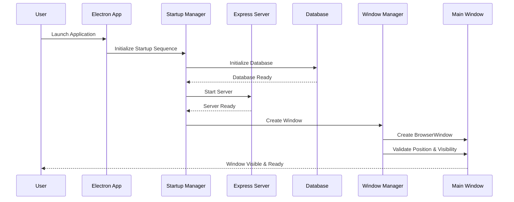
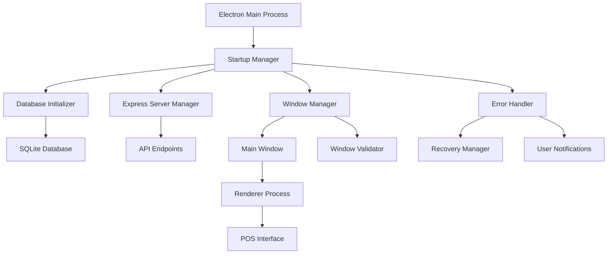

# Design Document: Electron Window Visibility Fix

## Overview

This design addresses the critical issue where the Electron.js Cafe POS application window does not appear or is not visible to users. The solution involves implementing robust startup sequence management, comprehensive error handling, window positioning validation, and recovery mechanisms to ensure reliable application initialization and window visibility.

The core problem stems from the complex startup dependencies where the Express server must initialize successfully before the Electron window can be created, along with potential issues in window positioning, error handling, and resource availability.

## Architecture

### Component Interaction Flow



### System Architecture



## Components and Interfaces

### 1. Startup Manager

**Purpose**: Orchestrates the application initialization sequence and ensures proper dependency order.

**Interface**:
```typescript
interface StartupManager {
  initializeApp(): Promise<void>
  validateDependencies(): Promise<boolean>
  handleStartupError(error: Error): void
  getStartupStatus(): StartupStatus
}

interface StartupStatus {
  database: 'pending' | 'ready' | 'failed'
  server: 'pending' | 'ready' | 'failed'
  window: 'pending' | 'ready' | 'failed'
  overall: 'initializing' | 'ready' | 'failed'
}
```

**Responsibilities**:
- Coordinate startup sequence timing
- Validate each component before proceeding
- Provide startup progress feedback
- Handle component initialization failures

### 2. Enhanced Window Manager

**Purpose**: Manages window creation, positioning, and visibility validation with robust error handling.

**Interface**:
```typescript
interface WindowManager {
  createMainWindow(): Promise<BrowserWindow>
  validateWindowPosition(window: BrowserWindow): boolean
  ensureWindowVisibility(window: BrowserWindow): void
  handleWindowCreationError(error: Error): Promise<BrowserWindow>
}

interface WindowConfig {
  width: number
  height: number
  minWidth: number
  minHeight: number
  x?: number
  y?: number
  show: boolean
  center: boolean
}
```

**Responsibilities**:
- Create window with safe default settings
- Validate window position within display bounds
- Ensure window visibility and focus
- Handle window creation failures with recovery

### 3. Server Manager

**Purpose**: Manages Express server startup with port conflict resolution and health validation.

**Interface**:
```typescript
interface ServerManager {
  startServer(preferredPort?: number): Promise<ServerInfo>
  findAvailablePort(startPort: number): Promise<number>
  validateServerHealth(): Promise<boolean>
  stopServer(): Promise<void>
}

interface ServerInfo {
  port: number
  host: string
  status: 'starting' | 'ready' | 'failed'
  url: string
}
```

**Responsibilities**:
- Start Express server with port conflict resolution
- Validate server health and API availability
- Provide server status information
- Handle server startup failures

### 4. Database Manager

**Purpose**: Handles database initialization with retry logic and validation.

**Interface**:
```typescript
interface DatabaseManager {
  initializeDatabase(): Promise<void>
  validateSchema(): Promise<boolean>
  retryConnection(maxAttempts: number): Promise<void>
  getDatabaseStatus(): DatabaseStatus
}

interface DatabaseStatus {
  connected: boolean
  schemaValid: boolean
  lastError?: string
}
```

**Responsibilities**:
- Initialize SQLite database connection
- Validate and create database schema
- Implement retry logic for connection issues
- Provide database health status

## Data Models

### Startup Configuration

```typescript
interface StartupConfig {
  server: {
    preferredPort: number
    fallbackPorts: number[]
    maxRetries: number
    healthCheckTimeout: number
  }
  window: {
    defaultWidth: number
    defaultHeight: number
    minWidth: number
    minHeight: number
    centerOnScreen: boolean
    showImmediately: boolean
  }
  database: {
    path: string
    maxRetries: number
    retryDelay: number
  }
  timeouts: {
    startupTimeout: number
    serverStartTimeout: number
    windowCreateTimeout: number
  }
}
```

### Error Information

```typescript
interface StartupError {
  component: 'database' | 'server' | 'window' | 'general'
  code: string
  message: string
  details?: any
  timestamp: Date
  recoverable: boolean
  suggestedAction?: string
}
```

## Correctness Properties

*A property is a characteristic or behavior that should hold true across all valid executions of a system-essentially, a formal statement about what the system should do. Properties serve as the bridge between human-readable specifications and machine-verifiable correctness guarantees.*

### Property 1: Startup Sequence Ordering
*For any* application startup attempt, the database must be initialized successfully before the Express server starts, and the Express server must be ready before the main window is created.
**Validates: Requirements 1.1**

### Property 2: Comprehensive Window Positioning
*For any* window creation, the window must be positioned within the primary display's visible work area, automatically repositioned if initially off-screen, scaled appropriately for small displays, have focus, and be fully responsive to user input.
**Validates: Requirements 1.5, 2.1, 2.2, 2.3, 2.4, 2.5**

### Property 3: Server Startup with Port Resolution
*For any* server startup attempt, if the default port is unavailable, the system must automatically try alternative ports in sequence, and if all server startup attempts fail, display a clear error message and exit gracefully.
**Validates: Requirements 1.2, 3.2, 5.1**

### Property 4: Database Initialization with Retry
*For any* database initialization attempt, if the database fails to initialize, the system must retry up to 3 times, validate and repair schema if needed, and if all attempts fail, display a descriptive error message and prevent window creation.
**Validates: Requirements 1.3, 4.2, 5.3**

### Property 5: Comprehensive Error Handling
*For any* error during startup, the system must log detailed error information, display user-friendly error dialogs for critical errors, provide progress feedback during slow operations, and attempt recovery with clear instructions when recovery fails.
**Validates: Requirements 3.1, 3.3, 3.4, 3.5, 5.5**

### Property 6: System Validation and Health Checks
*For any* startup sequence, the system must verify all required files and dependencies are available, validate API endpoint health, confirm HTML content loads successfully, and send an 'app-ready' event only when all validation passes.
**Validates: Requirements 4.1, 4.3, 4.4, 4.5**

### Property 7: Window Recovery and Fallback
*For any* window creation failure, the system must attempt to recreate the window with safe default settings, display fallback error pages when HTML fails to load, and ensure successful window creation within the configured timeout.
**Validates: Requirements 1.4, 5.2, 5.4**

## Error Handling

### Error Categories and Responses

1. **Database Initialization Errors**
   - File permission issues → Display admin privileges dialog
   - Schema corruption → Attempt schema recreation
   - Connection timeout → Retry with exponential backoff

2. **Server Startup Errors**
   - Port in use → Try alternative ports automatically
   - Permission denied → Display firewall/admin dialog
   - Module loading errors → Display dependency error dialog

3. **Window Creation Errors**
   - Display not available → Use safe default positioning
   - Memory allocation failure → Reduce window size and retry
   - Renderer process crash → Recreate window with minimal configuration

4. **Resource Availability Errors**
   - Missing HTML files → Display file integrity error
   - Missing dependencies → Display installation repair dialog
   - Insufficient system resources → Display system requirements dialog

### Recovery Strategies

```typescript
interface RecoveryStrategy {
  errorType: string
  maxAttempts: number
  retryDelay: number
  fallbackAction: () => Promise<void>
  userNotification: string
}
```

## Testing Strategy

### Unit Testing Approach
- **Startup Manager**: Test initialization sequence, dependency validation, error handling
- **Window Manager**: Test window creation, positioning validation, visibility checks
- **Server Manager**: Test port resolution, health checks, startup/shutdown cycles
- **Database Manager**: Test connection handling, schema validation, retry logic

### Property-Based Testing Configuration
- **Testing Framework**: Use fast-check for JavaScript property-based testing
- **Test Iterations**: Minimum 100 iterations per property test
- **Test Environment**: Mock Electron APIs and system resources for consistent testing
- **Coverage**: Each correctness property implemented as a separate property-based test

### Integration Testing
- **End-to-End Startup**: Test complete application startup under various system conditions
- **Error Simulation**: Inject failures at different startup stages to validate recovery
- **Resource Constraints**: Test behavior under low memory, disk space, and network conditions
- **Multi-Display**: Test window positioning across different display configurations

### Testing Scenarios
- Normal startup with all resources available
- Database file locked by another process
- Server port conflicts with existing services
- Window creation on systems with multiple displays
- Startup during system resource constraints
- Recovery from partial initialization failures